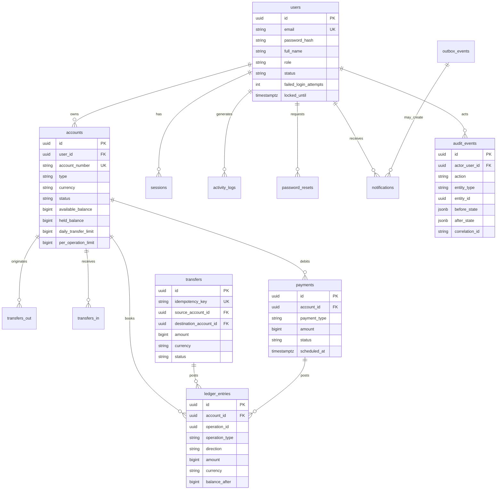

# Modelo de datos inicial

**Documento:** DAT-001  
**Fase:** 0  
**Estado:** En revisión

Principios:

1. El **ledger** es la fuente de verdad del dinero. El saldo en `accounts` es caché reconciliable. Ver [ADR-0002](adr/0002-ledger-as-source-of-truth.md).
2. El dinero se persiste en **enteros de unidad menor** (centavos). Ver [ADR-0004](adr/0004-money-as-integer-cents.md).
3. La auditoría es **append-only** y no se expone completa por API. Ver [ADR-0005](adr/0005-audit-without-public-api.md).
4. Constraints en base: QA no depende de que la API “se porte bien”.

## 1. Diagrama ER

## 2. Tablas y reglas

### 2.1 `users`

| Columna | Notas |
| --- | --- |
| `email` | UNIQUE, CITEXT |
| `password_hash` | Argon2 |
| `role` | `CUSTOMER` \| `SUPPORT` \| `ADMIN` |
| `status` | `PENDING_VERIFICATION` \| `ACTIVE` \| `LOCKED` \| `DISABLED` |
| `failed_login_attempts` | Reset en login exitoso |
| `locked_until` | NULL si no hay bloqueo |

Checks: `role` y `status` como enum/check constraint.

### 2.2 `sessions`

Refresh token **hasheado**. `revoked_at` permite logout y rotación. Metadata (`ip`, `user_agent`) alimenta `activity_logs`.

### 2.3 `password_resets`

`token_hash`, `expires_at`, `used_at`. El token en claro **no** se persiste. En `dev`/`test` el mock de email deja el token en `notifications.payload` para E2E; en perfil `prod` (código defensivo) jamás viaja en una respuesta JSON.

### 2.4 `accounts`

| Columna | Notas |
| --- | --- |
| `account_number` | 22 dígitos ficticios, UNIQUE |
| `type` | `CHECKING` \| `SAVINGS` |
| `currency` | `ARS` \| `USD` |
| `status` | `ACTIVE` \| `BLOCKED` \| `CLOSED` |
| `available_balance` | bigint ≥ 0 (check) |
| `held_balance` | bigint ≥ 0 |
| `daily_transfer_limit` | unidad menor |
| `per_operation_limit` | unidad menor |

Índice `(user_id, status)`.

### 2.5 `ledger_entries`

Libro de doble entrada a nivel de cuenta:

- `direction`: `DEBIT` \| `CREDIT`
- `amount` > 0
- `operation_type`: `TRANSFER` \| `PAYMENT` \| `FEE` \| `ADJUSTMENT`
- `operation_id` + `operation_type` identifican el origen
- `balance_after` snapshot para diagnóstico, no fuente de verdad

Una transferencia COMPLETED produce **dos** filas. Un pago COMPLETED produce **una** (débito). No hay cuentas puente en v1.

### 2.6 `transfers`

- Unique `(initiator_user_id, idempotency_key)` además de `id`.
- `status` con check.
- `rejection_reason` NULL si no aplica.
- `correlation_id` NOT NULL.

### 2.7 `payments`

- `payment_type`: `SERVICE` \| `CARD` \| `INVOICE` \| `SCHEDULED`
- `provider` fijo a `mock-gateway` en v1
- `external_reference` del mock
- Unique idempotency por usuario

### 2.8 `notifications`

Canal `EMAIL` \| `SMS` \| `IN_APP`. Estado `QUEUED` \| `SENT` \| `FAILED`. `payload` JSONB sintético.

### 2.9 `audit_events`

Sin `UPDATE`/`DELETE` de aplicación. Privilegio de rol DB de la API: `INSERT` + `SELECT` limitado. QA usa un rol de lectura aparte.

**No hay** `GET /admin/audit` completo. Puede existir `GET /admin/operations/:id` con rastro operativo reducido (FR-AUD-004), insuficiente para cerrar FR-AUD-001.

### 2.10 `outbox_events`

`event_type`, `payload`, `created_at`, `published_at`. El publisher del API o un loop del worker marca publicado. Data tests pueden comparar `outbox_events` vs `notifications` vs operación origen.

### 2.11 `activity_logs`

Vista de usuario: login, logout, cambio de perfil, transferencias propias. Distinto de `audit_events`.

## 3. Integridad que QA comprobará en SQL (independiente de API)

Estas reglas se implementan como tests de datos en Fase 6. Se declaran ahora para que el modelo no las haga imposibles.

| ID regla | Afirmación SQL |
| --- | --- |
| DR-001 | No hay `ledger_entries.account_id` huérfano |
| DR-002 | Transfer `COMPLETED` ⇔ exactamente 1 débito y 1 crédito con mismo `amount` y `currency` |
| DR-003 | Transfer `REJECTED`/`FAILED` ⇔ 0 ledger entries |
| DR-004 | `accounts.available_balance` = suma neta del ledger − `held_balance` (fórmula a fijar en Fase 2 y congelar) |
| DR-005 | Usuario `LOCKED`/`DISABLED` no origina transfers `COMPLETED` posteriores al lock |
| DR-006 | Cuenta `BLOCKED` no aparece como `source_account_id` de un COMPLETED posterior al bloqueo |
| DR-007 | Todo transfer COMPLETED tiene `audit_events` con `entity_id` coincidente |
| DR-008 | `amount` > 0 en ledger y transfers |
| DR-009 | No hay dos transfers COMPLETED con la misma `idempotency_key` de un mismo usuario |
| DR-010 | Moneda de ledger = moneda de la cuenta |

## 4. Datos sintéticos

Seeds de desarrollo (Fase 2):

- 1 ADMIN, 1 SUPPORT, 3 CUSTOMER.
- Cuentas ARS/USD, una cuenta BLOCKED, una con saldo 0, una cerca del límite diario.
- Historial corto de transfers y payments para UI.

Factories de test generan UUIDs y emails únicos (`qa+{uuid}@finbank.test`). Nunca nombres o documentos reales.

## 5. Lo que el modelo habilita “sin API”

Ejemplos de requisitos cuya evidencia primaria **no** es un endpoint:

| Requisito | Evidencia |
| --- | --- |
| FR-TRF-008 | `ledger_entries` |
| FR-TRF-010 / FR-AUD-001 | `audit_events` |
| FR-AUD-002 | triggers o ausencia de update + grants |
| FR-NTF-002 | `notifications` + `outbox_events` |
| FR-AUTH-007 | `password_resets.used_at` / `expires_at` |
| FR-ACCT-006 | reconciliación saldo vs ledger |
