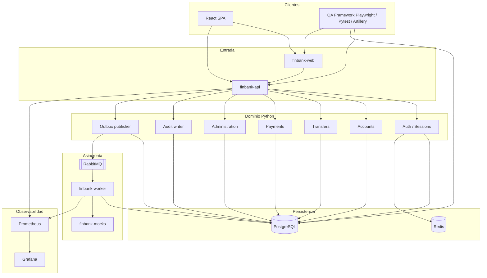
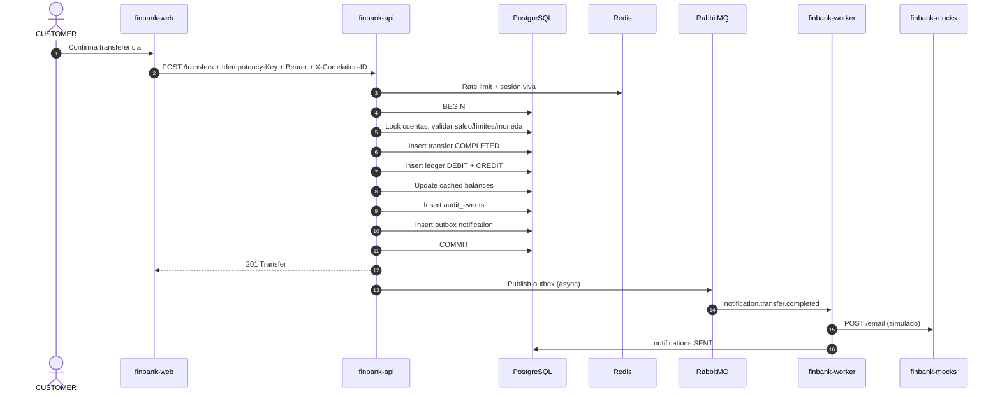
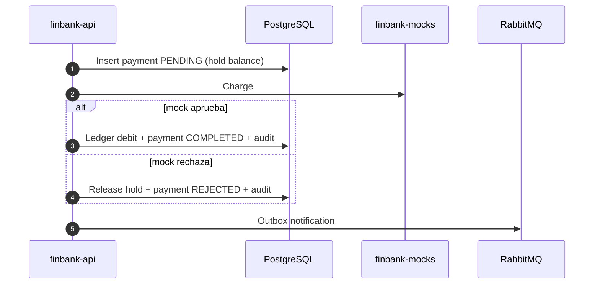
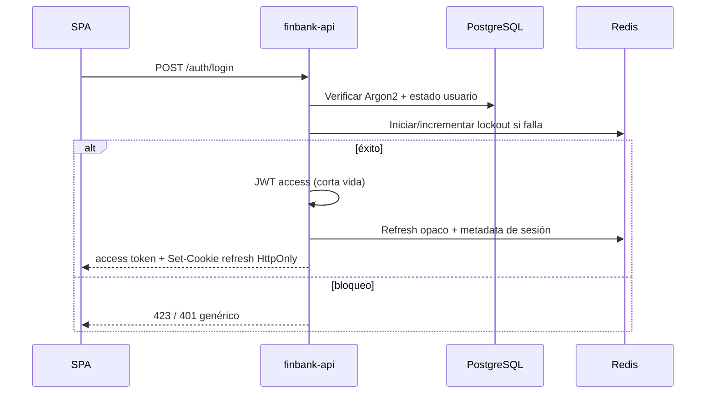

# Arquitectura del sistema

**Documento:** ARC-001  
**Fase:** 0  
**Estado:** En revisión

## 1. Decisión estructural

FinBank se implementa como **monolito modular** con tres procesos de aplicación y dependencias de infraestructura, no como red de microservicios.

| Proceso | Responsabilidad |
| --- | --- |
| `finbank-web` | SPA React servida por Vite en dev / nginx en compose |
| `finbank-api` | API REST FastAPI: auth, cuentas, transferencias, pagos, admin |
| `finbank-worker` | Consumidores RabbitMQ: notificaciones y pagos programados |
| `finbank-mocks` | Pasarela de pagos y notificaciones externas simuladas |

Misma codebase Python para API y worker (`apps/backend`), distinto entrypoint. Así las reglas de dominio se testean una vez (TDD) y no se duplican.

**Por qué no microservicios:** el objetivo es profundidad QA sobre un SUT realista, no orquestar diez contratos de red. Un monolito modular permite ledger atómico, data testing sobre una base, y chaos testing real (Redis, Postgres, Rabbit, mocks) sin inventar sagas. Ver [ADR-0001](adr/0001-modular-monolith.md).

## 2. Diagrama de componentes



## 3. Diagrama de interacción entre servicios

### 3.1 Transferencia COMPLETED (camino feliz)



La consistencia monetaria vive en la transacción SQL. El email es **al menos una vez** vía outbox; no forma parte del commit de saldos. QA valida ambas capas por separado: ledger atómico (SQL) y notificación eventual (tabla `notifications` + eventos).

### 3.2 Pago contra pasarela mock



En tests unitarios la pasarela es un puerto inyectado (`PaymentGateway`). En integración se usa `finbank-mocks`. En E2E aislados de UI, Playwright puede interceptar; no sustituye la integración real con el mock server.

### 3.3 Autenticación y sesión



Detalle en [ADR-0003](adr/0003-auth-jwt-redis.md).

## 4. Capas internas del backend

```text
apps/backend/src/finbank/
  api/            # routers HTTP, dependencia de auth, correlation ID
  schemas/        # Pydantic request/response
  services/       # orquestación
  domain/         # reglas puras (TDD, sin I/O) — límites, idempotencia, estados
  repositories/   # SQLAlchemy
  models/         # ORM
  workers/        # consumers
  core/           # config, logging, security, defect flags
  adapters/       # PaymentGateway, NotificationGateway
```

Regla: **el dominio no importa FastAPI ni RabbitMQ**. Eso permite TDD sin mocks de infraestructura y mutation testing enfocado en reglas.

## 5. Frontend

SPA por dominios: `auth`, `accounts`, `transfers`, `payments`, `admin`, `profile`. Rutas protegidas por rol. Formularios con validación cliente + errores de API. El frontend no es fuente de verdad: cualquier control de UI se revalida en backend.

## 6. Límites de confianza (trust boundaries)

1. Navegador → API: no confiable. AuthZ siempre en servidor.
2. API → PostgreSQL: confiable dentro de la red compose.
3. API → Redis/Rabbit/mocks: no confiables; timeouts y degradación.
4. QA → PostgreSQL: canal de evidencia, no de producto. Credenciales de test distintas.
5. Defect flags: solo `APP_ENV=test|ci`.

## 7. Entornos

| Entorno | Compose | Defect lab | Datos |
| --- | --- | --- | --- |
| `dev` | sí | off | seeds de demo |
| `test` | sí | opt-in por flag | factories + rollback |
| `ci` | sí | opt-in | efímero |
| `prod` | no aplica | imposible de activar | no existe prod real |

No hay ambiente productivo. El perfil `prod` en código existe para **prohibir** defect flags y tokens de recovery en respuestas.

## 8. Observabilidad

- Middleware: correlation ID, timing, status.
- `structlog` JSON.
- Contadores y histogramas Prometheus: requests, transferencias por estado, lag de outbox, rechazos de login.
- Grafana provisionado en `infrastructure/monitoring/`.

## 9. Lo que esta arquitectura habilita en QA

| Pregunta de calidad | Dónde se verifica |
| --- | --- |
| ¿La UI muestra el saldo correcto? | E2E + API + SQL |
| ¿El ledger cuadra? | Data tests, sin endpoint de reconciliación |
| ¿El audit existe? | SQL directo (FR-AUD-003) |
| ¿SUPPORT no transfiere? | API authz + E2E negativo |
| ¿Redis caído? | Chaos + error handling |
| ¿El mock de pagos rechaza? | Integration + contract |
| ¿Un defecto inyectado se detecta? | Defect lab matrix |
