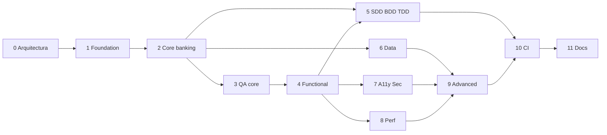

# Roadmap de implementación

**Documento:** RMP-001  
**Fase:** 11  
**Regla:** no se inicia una fase sin DoD de la anterior, salvo trabajo documental paralelo explícito.

## Vista

```text
0 Discovery          ✓ aprobada
1 Foundation         ✓ verificada
2 Core banking       ✓ verificada
3 QA framework core  ✓ verificada
4 Functional tests   ✓ verificada
5 SDD/BDD/TDD        ✓ verificada
6 Data testing       ✓ verificada
7 A11y + security    ✓ verificada
8 Performance        ✓ verificada
9 Advanced           ✓ verificada
10 CI/CD             ✓ verificada
11 Portfolio         ✓ verificada
```

## Fase 0 — Discovery

**DoD:** documentos de visión, alcance, arquitectura, datos, QA, RTM, estructura, roadmap, riesgos, ADRs. Aprobación humana. Cero código de SUT. **Cumplido.**

## Fase 1 — Foundation

- Compose: Postgres, Redis, RabbitMQ, API, worker, web, Prometheus, Grafana.
- Health checks reales (`/health` liveness, `/ready` con dependencias).
- Makefile `up`, `down`, `logs`, `ready`, `test`.
- **DoD:** `docker compose ps` healthy. Lint/typecheck. Pytest + Vitest. SPA muestra componentes up. **Cumplido.**

Pendiente explícito: GitHub remoto (cuando se pida).

## Fase 2 — Core banking

TDD sobre `domain/` primero. Luego repositorios, API, UI de flujos críticos, seeds.

**DoD:** registro, login, cuentas, transferencia, pago mock, admin bloqueo. Pytest verde sobre reglas. Migraciones reproducibles. **Cumplido.**

## Fase 3 — QA framework core

Proyecto `qa/` compilando. Fixtures de rol, clientes, POM del login y dashboard. Un test smoke que pega al SUT de Fase 2.

**DoD:** `make qa-smoke` en Docker. No tests vacíos. **Cumplido** (8 tests `@smoke` verdes: 6 API + 2 E2E Chromium).

## Fase 4 — Functional testing

Happy/negative/edge en E2E y API. Tags smoke/regression.

**DoD:** critical path verde en Chromium. Firefox/WebKit en pipeline de main, no obligatorios en el primer PR interno. **Cumplido** (`make qa-regression`: 53 tests verdes, API + E2E Chromium).

## Fase 5 — SDD / BDD / TDD

Features Gherkin enlazadas a FR-*. RTM con IDs de test reales. Completar unitarios de límites e idempotencia.

**DoD:** Cucumber corre al menos auth + transfers. RTM sin críticos huérfanos. **Cumplido** (`make qa-bdd`: 6 escenarios / 25 steps, auth + transfers).

## Fase 6 — Data testing

SQL assertions, factories, reconciliación, transacción, caso audit-sin-API documentado y ejecutable.

**DoD:** un test que transfiere por API y afirma `audit_events` y ledger **sin** usar un GET de auditoría. **Cumplido** (`make qa-data`: 7 tests, incl. 404 de GET /audit + SELECT `audit_events`/`ledger_entries`).

## Fase 7 — Accessibility y security

axe en rutas críticas, charter manual WCAG, tests authz, headers, dependency audit, ZAP baseline local.

**DoD:** reporte axe real; 403 de SUPPORT; `.env` no commiteado. **Cumplido** (`make qa-a11y` 6 tests / axe `violations: []`; `make qa-security` SUPPORT 403; `.env` en `.gitignore`).

## Fase 8 — Performance

Artillery login/cuentas/transfers. Correr una vez, anotar p50/p95 reales, ajustar presupuestos.

**DoD:** umbrales basados en medición, no en fantasía. Informe en `docs/performance/`. **Cumplido** (`make qa-perf`; presupuestos en `docs/performance/budgets.md`).

## Fase 9 — Advanced

Defect lab con ≥1 defecto por categoría y test detector. Pact. mutmut/Stryker sample. Chaos Redis/Rabbit. Charters exploratorios. TDM documentado.

**DoD:** matriz de detección con al menos un defecto ON que rompe un test concreto. **Cumplido** (`make qa-lab-detect` 7/7).

## Fase 10 — CI/CD

Workflows PR/main/nightly. GitLab equivalente. Quality gate: unit + API smoke + E2E critical + data smoke. Artefactos Allure/JUnit.

**DoD:** un fallo de test crítico pone la pipeline en rojo. Documentado. **Cumplido** (`scripts/ci/require-jobs.py`, job `quality-gate`, `.gitlab-ci.yml` needs).

## Fase 11 — Portfolio

README de demo, interview guide, troubleshooting, recorte de evidencias **generadas**, no inventadas.

**DoD:** evaluador puede clonar, levantar, smoke/E2E/SQL; RTM; lab dual OFF/ON; docs explican *por qué*. **Cumplido** (demo, entrevista, troubleshooting, [evidencia 2026-11-03](evidence/2026-11-03.md)). El remoto GitHub/GitLab queda como paso del autor al publicar el repo.

## Dependencias entre fases



Fase 5 puede solaparse con 4 en documentación de features, no en steps verdes antes de que el SUT exista.
